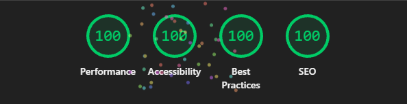
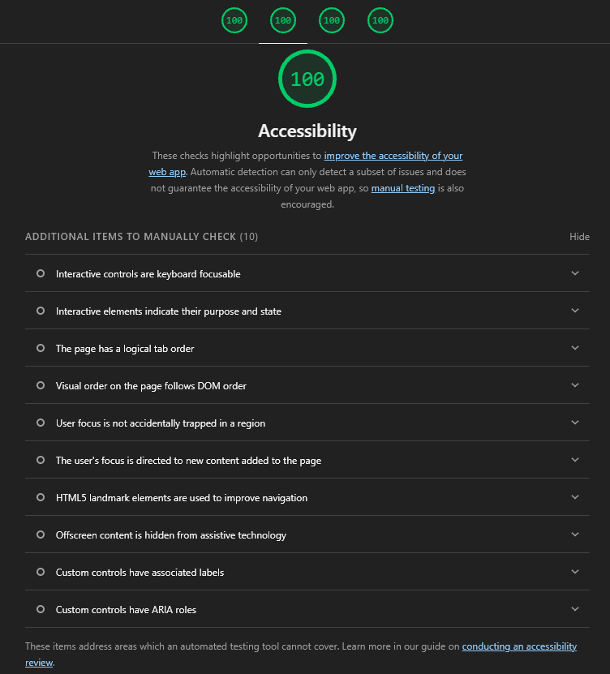

# BuscaAnime

[](https://nextjs.org)
[](https://react.dev)
[](https://www.typescriptlang.org)
[](https://tailwindcss.com)
[](https://graphql.org)
[](https://nx.dev)
[](https://pnpm.io)
[](https://vitest.dev)
[](https://playwright.dev)
[](https://storybook.js.org)
[](https://eslint.org)
[](https://prettier.io)
[](https://sentry.io)
[](https://github.com/danilolpa/buscanime-winnin/actions/workflows/ci.yml)
[](https://buscanime-winnin-web.vercel.app/)

**[buscanime-winnin-web.vercel.app](https://buscanime-winnin-web.vercel.app/)**

---

## Por que um monorepo?

Para uma página de listagem de animes, é muito. Mas foi intencional.

Um `create-next-app` resolveria o desafio. A escolha pelo monorepo existe para mostrar como eu pensaria numa base de código que aguentasse crescer, não só o que entrega o MVP.

No monorepo, a biblioteca de componentes (`@buscanime/ui`) não sabe nada sobre dados. Nenhum componente faz fetch, nenhum conhece o TanStack Query. Essa separação não é só convenção — o ESLint quebra o build se um componente de UI tentar importar um hook de dados. É a forma de não depender da disciplina de todo o time quando o projeto crescer.

O reuso vem junto. Hoje tem um app. Se aparecer um painel admin ou um app mobile, eles consumiriam os mesmos componentes e os mesmos hooks sem copiar código. Com um repositório simples você percebe essa necessidade tarde demais.

O Nx cuida do resto: cache de build, execução paralela, grafo de dependências entre pacotes. Para um projeto pequeno é custo zero no dia a dia — `nx dev web` é igual a `next dev`. A diferença aparece quando o CI começa a demorar.

Mas sim, para uma página de animes, é muito. Era esse o ponto.

---

## Tech stack

| Concern   | Technology                                                                    |
| --------- | ----------------------------------------------------------------------------- |
| Core      | Next.js 16 (App Router, Turbopack), React 19, TypeScript 5.9, Tailwind CSS v4 |
| Data      | TanStack Query v5, graphql-request 7, GraphQL Code Generator 7                |
| Workspace | Nx 23, pnpm 11                                                                |
| Testing   | Vitest 4 + Testing Library + MSW 2, Playwright, Storybook 10                  |
| Qualidade | ESLint 9, Prettier 3, commitlint + husky + lint-staged, Sentry 10             |

---

## Estrutura de pastas

```
buscanime/
├── apps/
│   ├── web/                        # Aplicação Next.js (App Router)
│   │   ├── src/app/
│   │   │   ├── (home)/             # Rota principal — listagem de animes
│   │   │   │   ├── anime-browser.tsx       # Componente principal da página
│   │   │   │   ├── use-anime-filters.ts    # Hook de filtros sincronizados com a URL
│   │   │   │   └── format-options.ts       # Constantes e conversões de formato
│   │   │   ├── api/anilist/        # Route Handler — proxy para a API do AniList
│   │   │   ├── layout.tsx          # Layout raiz com metadata
│   │   │   ├── providers.tsx       # QueryClient e configuração de retry
│   │   │   └── error.tsx           # Boundary de erro global
│   │   └── specs/                  # Testes de integração da página
│   │
│   └── web-e2e/                    # Testes E2E com Playwright
│
├── libs/
│   ├── ui/                         # @buscanime/ui — biblioteca de componentes
│   │   ├── src/lib/                # Componentes (Button, AnimeCard, SearchBar…)
│   │   ├── src/styles/             # Design tokens (CSS custom properties)
│   │   └── .storybook/             # Configuração do Storybook
│   │
│   ├── anime/
│   │   └── data-access/            # @buscanime/anime-data-access
│   │       └── src/lib/            # Hooks TanStack Query + SDK GraphQL gerado
│   │
│   └── shared/
│       └── types/                  # @buscanime/shared-types — interfaces compartilhadas
│
├── docs/                           # Specs e planos de cada fase (Spec Driven Development)
└── .github/workflows/              # CI/CD (lint, testes, build)
```

---

## Por baixo do capô

**O browser nunca fala com a AniList direto.**

Toda chamada GraphQL passa pelo Route Handler `/api/anilist`, que age como proxy transparente. Ele recebe a requisição, repassa pra AniList, e devolve a resposta com o mesmo status code.

Parece burocracia, mas cria um ponto único onde coisas úteis acontecem: log de latência em cada request, captura de erro no Sentry quando a upstream falha, e espaço para qualquer controle futuro — throttling, cache, autenticação — sem mexer em nada no cliente.

```
browser → /api/anilist (Route Handler) → graphql.anilist.co
```

O cliente só conhece o proxy. Se a AniList mudar de endereço, trocar de protocolo, ou precisar de um header de autenticação, o ajuste fica num arquivo só.

**Erros têm tratamento específico, não genérico.**

A AniList tem rate limit. Quando ele estoura, a API devolve 429 — e a resposta certa não é tentar de novo, é avisar o usuário e parar. O `QueryClient` detecta o 429 via duck-typing e cancela qualquer retry automático. Para todo o resto, tenta até 3 vezes antes de mostrar erro.

Na interface, cada situação tem seu estado próprio:

- **Rate limit (429)** — avisa que muitas buscas foram feitas e oferece botão para tentar de novo manualmente.
- **Erro de upstream** — mostra que algo deu errado com opção de retry.
- **Sem resultados** — diferencia de erro: informa que a busca não encontrou nada.

Quando o proxy falha em chegar na AniList, o erro é capturado pelo Sentry antes de devolver um 502 pro cliente.

---

## Como executar

### Pré-requisitos

- Node.js 20+
- pnpm 11

```bash
pnpm install
```

---

### Aplicação web

```bash
pnpm exec nx dev web
```

Acesse em `http://localhost:3000`.

---

### Testes unitários

```bash
# Todos os projetos de uma vez
pnpm exec nx run-many -t test

# Por projeto
pnpm exec nx test web
pnpm exec nx test ui
pnpm exec nx test anime-data-access
```

---

### Testes E2E

Os testes E2E sobem o servidor automaticamente antes de rodar. A API AniList é **mockada** via interceptação do Playwright em `/api/anilist` (mesmos fixtures do MSW em `anime-browser.spec.tsx`), evitando rate limit (429) e tornando a suíte rápida e determinística. O proxy real continua coberto em `route.spec.ts` e nos testes de integração com MSW.

```bash
# Instalar os browsers do Playwright (primeira vez)
pnpm exec playwright install

pnpm exec nx e2e web-e2e
```

Cenários cobertos em `apps/web-e2e/src/anime-list.spec.ts`:

| Teste                                                   | O que valida                                                                                                                 |
| ------------------------------------------------------- | ---------------------------------------------------------------------------------------------------------------------------- |
| **carrega, filtra e busca animes**                      | Home carrega a grade, filtro "TV Show" reflete `format=TV` na URL, busca por "naruto" reflete `q=naruto` e mantém resultados |
| **restaura filtro e busca a partir da URL (deep link)** | Abrir `/?format=TV&q=naruto` restaura filtro ativo, input preenchido e resultados                                            |
| **"Ver mais" carrega a próxima página de resultados**   | Paginação acumula mais cards na grade após clicar em "Ver mais"                                                              |
| **limpar busca remove o termo da URL e volta à lista**  | Botão "Limpar busca" zera o input, remove `q` da URL e volta à listagem                                                      |
| **busca sem resultados mostra estado vazio**            | Termo inexistente exibe "Nada encontrado" e a grade fica vazia                                                               |

Estados de erro (502, 429) e badges de contagem por formato ficam nos testes de integração com MSW em `anime-browser.spec.tsx` — são mais rápidos e determinísticos para mockar respostas da API.

Para rodar só no Chromium (mais rápido localmente):

```bash
cd apps/web-e2e && pnpm exec playwright test --project=chromium
```

---

### Storybook

Catálogo interativo de todos os componentes da `@buscanime/ui`.

```bash
pnpm exec nx storybook ui
```

Acesse em `http://localhost:6006`.

---

### Tudo de uma vez (lint + typecheck + testes + build)

```bash
pnpm exec nx run-many -t lint typecheck test build
```

---

## Acessibilidade

O app pontua **100 no Lighthouse** em todas as categorias: Performance, Accessibility, Best Practices e SEO.

Antes de implementar, o Figma foi auditado. Um dos problemas encontrados foi o badge de score amarelo — a combinação de texto escuro sobre amarelo claro não atingia o contraste mínimo exigido pelo WCAG. A cor foi ajustada antes de virar código, não depois.

Cada componente da `@buscanime/ui` tem testes automatizados com `vitest-axe`, que roda o motor do axe-core direto no Vitest. Se um componente introduzir uma violação de acessibilidade, o teste quebra antes de chegar no PR.

Outras decisões que contribuíram para o score:

- `aria-label` é obrigatório no `Input` a nível de tipo TypeScript — não tem como usar o componente sem ele.
- Skeletons de carregamento têm `aria-busy="true"` e `aria-label` descritivo; elementos puramente decorativos levam `aria-hidden="true"` para não poluir a árvore de acessibilidade.
- A área de resultados usa `aria-live="polite"` e `aria-busy` para avisar leitores de tela quando uma nova busca está em andamento.
- `SearchBar` é um `<form role="search">`, botões de toggle têm `aria-pressed`, e o layout usa elementos semânticos (`<article>`, `<header>`, `<footer>`) em vez de `<div>` genérico.





---

## CI/CD

O GitHub Actions roda em todo push para `main` e em pull requests. O pipeline executa em sequência:

1. Instala dependências com lockfile congelado (`--frozen-lockfile`)
2. Instala os browsers do Playwright
3. Roda em paralelo via Nx: `lint`, `typecheck`, `test`, `build` e `e2e`

O deploy na Vercel é automático a cada merge na `main`.

---

## Variáveis de ambiente

| Variável                 | Obrigatória | Descrição                                                                |
| ------------------------ | ----------- | ------------------------------------------------------------------------ |
| `NEXT_PUBLIC_SENTRY_DSN` | Não         | DSN do Sentry para captura de erros. O app funciona normalmente sem ela. |
