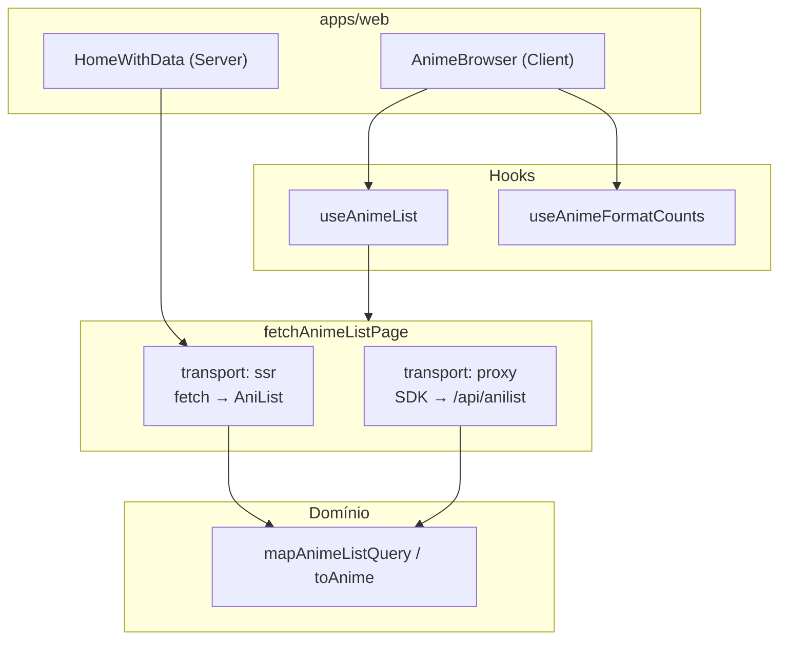

# @buscanime/anime-data-access

Camada de acesso a dados da AniList para o monorepo BuscaAnime. Centraliza transporte HTTP, mapeamento GraphQL → domínio e hooks React Query.

## Estrutura

```
src/lib/
├── graphql/           # Queries .graphql + código gerado (codegen)
├── anilist/           # Infra compartilhada (endpoint, SDK proxy, erros)
├── anime-list/        # Listagem paginada (SSR + infinite query)
└── format-counts/     # Badges de contagem por formato na busca
```

## Fluxo de dados



## Quando usar o quê

| Preciso de…                        | Importar                                                 |
| ---------------------------------- | -------------------------------------------------------- |
| Hook na UI (listagem + "Ver mais") | `useAnimeList`                                           |
| Badges por formato durante busca   | `useAnimeFormatCounts`                                   |
| Prefetch / SSR no Server Component | `fetchAnimeListPage`, `getAnimeListInfiniteQueryOptions` |
| Tipo de retorno da listagem        | `AnimeListPageResult`                                    |
| Detectar rate limit (429)          | `isRateLimitError`                                       |
| Flag SSR nos e2e                   | `isSsrListingEnabled` em `apps/web` (não nesta lib)      |

## Transporte unificado

`fetchAnimeListPage` é o único ponto de fetch da listagem:

- **`transport: 'ssr'`** — `fetch` nativo → AniList direto (Server Components, Data Cache Next.js)
- **`transport: 'proxy'`** — `graphql-request` → `/api/anilist` (browser, jsdom)
- **Default** — `ssr` no Node, `proxy` no browser

## Scripts

```bash
pnpm exec nx run @buscanime/anime-data-access:lint
pnpm exec nx run @buscanime/anime-data-access:test
pnpm exec nx run @buscanime/anime-data-access:build
```

## Codegen

Queries ficam em `src/lib/graphql/queries/`. Após editar `.graphql`:

```bash
pnpm exec graphql-codegen --config libs/anime/data-access/codegen.ts
```

Não editar arquivos em `graphql/generated/` manualmente.
