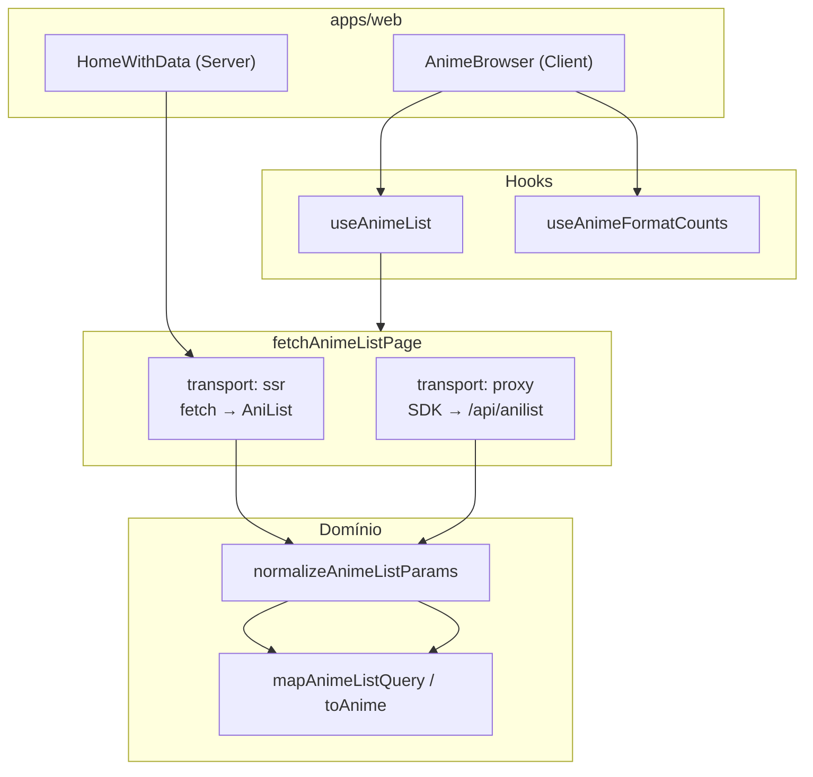

# @buscanime/anime-data-access

Camada de acesso a dados da AniList para o monorepo BuscaAnime. Centraliza transporte HTTP, mapeamento GraphQL → domínio e hooks React Query.

**Responsabilidade:** falar com a AniList e devolver tipos de domínio (`Anime`, paginação, contagens). Não conhece rotas Next.js, layout ou componentes de UI.

> Cada função exportada também possui JSDoc no código-fonte (`src/lib/**`). Este README é a visão geral; o código é a referência inline no IDE.

---

## Estrutura

```
src/lib/
├── graphql/
│   ├── queries/           # Queries .graphql (fonte da verdade)
│   └── generated/         # Tipos + SDK gerados pelo codegen (não editar)
├── anilist/               # Infra HTTP compartilhada (endpoint, SDK proxy, erros)
├── anime-list/            # Listagem paginada (SSR + infinite query)
├── anime-detail/          # Detalhe de um anime por id (SSR)
└── format-counts/         # Badges de contagem por formato durante a busca
```

---

## Fluxo de dados



---

## Guia rápido: o que importar

| Preciso de…                        | Importar                                                 |
| ---------------------------------- | -------------------------------------------------------- |
| Hook na UI (listagem + "Ver mais") | `useAnimeList`                                           |
| Badges por formato durante busca   | `useAnimeFormatCounts`                                   |
| Prefetch / SSR no Server Component | `fetchAnimeListPage`, `getAnimeListInfiniteQueryOptions` |
| Tipo de retorno da listagem        | `AnimeListPageResult`                                    |
| Detalhe de um anime (SSR)          | `fetchAnimeDetail`                                       |
| Tipo de retorno do detalhe         | `AnimeDetail` (em `@buscanime/shared-types`)             |
| Detectar rate limit (429)          | `isRateLimitError`                                       |
| Flag SSR nos e2e                   | `isSsrListingEnabled` em `apps/web` (não nesta lib)      |

---

## Referência por módulo

### `anilist/` — transporte HTTP

Infraestrutura compartilhada para chegar na AniList. Não mapeia dados; só resolve **para onde** e **como** enviar a requisição.

#### `getAnilistEndpoint()`

**Arquivo:** `anilist/endpoint.ts`

Retorna a URL upstream da API GraphQL da AniList (`https://graphql.anilist.co` por padrão).

**Por que existe:** o transporte SSR (`fetchAnimeListPage` com `transport: 'ssr'`) precisa de um endpoint absoluto no servidor. Em testes ou ambientes customizados, sobrescreva com a variável de ambiente `ANILIST_ENDPOINT`.

**Quem usa:** `fetchViaSsr` (interno), testes que mockam a AniList diretamente.

---

#### `ANILIST_PROXY_ENDPOINT`

**Arquivo:** `anilist/client.ts`

Constante: `'/api/anilist'`.

**Por que existe:** no browser não chamamos a AniList direto (CORS, exposição de URL, rate limit). O app Next.js expõe um Route Handler que faz proxy server-side. O SDK aponta para esse caminho relativo.

**Quem usa:** `createAnilistSdk`, `fetchViaProxy`.

---

#### `createAnilistSdk(endpoint?)`

**Arquivo:** `anilist/client.ts`

Cria o SDK tipado (`graphql-request` + código gerado pelo codegen) para executar queries GraphQL.

| Parâmetro   | Descrição                                                                                     |
| ----------- | --------------------------------------------------------------------------------------------- |
| `endpoint?` | URL absoluta opcional. Default: `/api/anilist` resolvido contra `location.origin` no browser. |

**Por que existe:** centraliza a criação do client GraphQL. Evita repetir `GraphQLClient` + `getSdk` em cada hook/fetch. Em testes com MSW, passe URL absoluta (`http://localhost/api/anilist`) porque jsdom não aceita path relativo.

**Quem usa:** `fetchViaProxy`, `useAnimeFormatCounts`.

---

#### `isRateLimitError(error)`

**Arquivo:** `anilist/errors.ts`

Retorna `true` se o erro representa HTTP 429 (rate limit da AniList).

**Por que existe:** SSR usa `fetch` (erro com `.status`) e o browser usa `graphql-request` (erro com `.response.status`). Esta função unifica a detecção para a UI tratar "tente novamente" sem acoplar ao tipo de transporte.

**Quem usa:** componentes de erro em `apps/web`, testes e2e.

---

### `anime-list/` — listagem paginada

Feature completa da home: busca, filtro por formato, paginação infinita e SSR.

#### `ANIME_LIST_PER_PAGE`

**Arquivo:** `anime-list/constants.ts`

Valor: `12`.

**Por que existe:** único lugar que define quantos animes vêm por página. Mantém SSR, infinite query e query GraphQL alinhados.

---

#### `getAnimeListSort(search?)`

**Arquivo:** `anime-list/normalize.ts`

Deriva o array `MediaSort` enviado à AniList:

- Com termo de busca → `['SEARCH_MATCH']` (relevância)
- Sem busca → `['POPULARITY_DESC']` (populares)

**Por que existe:** a AniList exige sort explícito; a regra de negócio (busca vs. browse) fica aqui, não espalhada no fetch ou na UI.

**Quem usa:** `normalizeAnimeListParams` → `fetchAnimeListPage`.

---

#### `normalizeAnimeListParams(search?, format?)`

**Arquivo:** `anime-list/normalize.ts`

Normaliza entradas antes de qualquer chamada à API:

- Trim em `search` (string vazia vira `undefined`)
- Repassa `format` sem alteração
- Calcula `sort` via `getAnimeListSort`

Retorna `{ trimmed, format, sort }`.

**Por que existe:** garante que SSR, React Query e query key usem os **mesmos** parâmetros efetivos. Sem isso, prefetch no servidor e refetch no client poderiam divergir (espaços na busca, sort errado).

**Quem usa:** `fetchAnimeListPage`, `getAnimeListInfiniteQueryOptions`, `animeListQueryKey`.

---

#### `toAnime(media)`

**Arquivo:** `anime-list/transform.ts`

Converte um item GraphQL `Media` no tipo de domínio `Anime` (`@buscanime/shared-types`):

- Título: `english` → fallback `romaji` → `'Untitled'`
- `coverImage`, `averageScore`, `format`, `genres` com defaults seguros

**Por que existe:** isola o shape da API AniList do que a UI consome. Se a query GraphQL mudar campos, só este arquivo (e `mapAnimeListQuery`) precisam atualizar.

**Quem usa:** `mapAnimeListQuery`. Exportado para testes e reuso futuro (ex.: detail page).

---

#### `mapAnimeListQuery(data)`

**Arquivo:** `anime-list/map-query.ts`

Mapeia a resposta completa da query `AnimeList` para `AnimeListPageResult`:

```ts
{ items: Anime[]; pageInfo: { currentPage, hasNextPage } | null }
```

**Por que existe:** ponto único de transformação GraphQL → domínio após o fetch. Tanto SSR quanto proxy passam por aqui.

**Quem usa:** `fetchViaSsr`, `fetchViaProxy`.

---

#### `animeListQueryKey(format?, search?)`

**Arquivo:** `anime-list/query-key.ts`

Retorna a query key estável do TanStack Query:

```ts
['anime-list', format ?? null, trimmedSearch ?? null];
```

**Por que existe:** chaves previsíveis permitem prefetch SSR (`queryClient.prefetchInfiniteQuery`) e invalidação correta ao mudar filtro/busca. Usa os mesmos trims que `normalizeAnimeListParams`.

**Quem usa:** `getAnimeListInfiniteQueryOptions`, prefetch em `apps/web`.

---

#### `fetchAnimeListPage(params)`

**Arquivo:** `anime-list/fetch-page.ts`

**Ponto único de fetch** da listagem. Busca uma página e retorna `AnimeListPageResult`.

| Parâmetro    | Descrição                                                            |
| ------------ | -------------------------------------------------------------------- |
| `page`       | Número da página (1-based)                                           |
| `search?`    | Termo de busca                                                       |
| `format?`    | Filtro `MediaFormat`                                                 |
| `transport?` | `'ssr'` ou `'proxy'`. Default: `'ssr'` no Node, `'proxy'` no browser |
| `endpoint?`  | Só testes: URL absoluta para MSW                                     |

**Transportes:**

| Modo    | Como                                  | Quando                            |
| ------- | ------------------------------------- | --------------------------------- |
| `ssr`   | `fetch` POST → `getAnilistEndpoint()` | Server Components, prefetch, Node |
| `proxy` | `createAnilistSdk()` → `/api/anilist` | Browser, jsdom                    |

**Por que existe:** unifica dois caminhos de rede numa API só. A UI e o React Query não precisam saber se estão no servidor ou no client.

**Funções internas (não exportadas):**

| Função               | Papel                                                                          |
| -------------------- | ------------------------------------------------------------------------------ |
| `defaultTransport()` | Escolhe `proxy` se `window` existe, senão `ssr`                                |
| `fetchViaSsr(...)`   | Monta body GraphQL com `print(AnimeListDocument)`, cache Next `revalidate: 60` |
| `fetchViaProxy(...)` | Delega ao SDK gerado (`sdk.AnimeList(...)`)                                    |

**Quem usa:** `getAnimeListInfiniteQueryOptions`, prefetch SSR em `HomeWithData`.

---

#### `getAnimeListInfiniteQueryOptions(params?)`

**Arquivo:** `anime-list/query-options.ts`

Monta as opções completas de `useInfiniteQuery`:

- `queryKey` via `animeListQueryKey`
- `queryFn` → `fetchAnimeListPage` (incrementa `pageParam`)
- `getNextPageParam` → próxima página se `hasNextPage`
- `staleTime: 60_000` (alinha com revalidate SSR)

**Por que existe:** separa configuração do TanStack Query do hook React. Permite prefetch no servidor com **as mesmas opções** que o client usa na hidratação (`HydrationBoundary`).

**Quem usa:** `useAnimeList`, `apps/web` (prefetch).

---

#### `useAnimeList(params?)`

**Arquivo:** `anime-list/use-anime-list.ts`

Hook React: `useInfiniteQuery(getAnimeListInfiniteQueryOptions(params))`.

**Por que existe:** API ergonômica para componentes client (`AnimeBrowser`). Encapsula paginação "Ver mais" e re-fetch ao mudar filtros.

**Retorno:** objeto padrão do TanStack Query (`data.pages`, `fetchNextPage`, `hasNextPage`, `isLoading`, etc.).

---

#### Tipos exportados (`anime-list/types.ts`)

| Tipo                       | Descrição                                                                     |
| -------------------------- | ----------------------------------------------------------------------------- |
| `AnimeListPageResult`      | `{ items: Anime[]; pageInfo: { currentPage, hasNextPage } \| null }`          |
| `AnimeListQueryParams`     | `{ search?, format?, endpoint? }` — compartilhado entre hook, options e fetch |
| `UseAnimeListParams`       | Alias de `AnimeListQueryParams`                                               |
| `FetchAnimeListPageParams` | Params de `fetchAnimeListPage` (inclui `page`, `transport`)                   |
| `AnimeListTransport`       | `'ssr' \| 'proxy'`                                                            |

---

### `anime-detail/` — detalhe de um anime (SSR)

Feature de detalhe: busca um único anime por id no servidor e mapeia o resultado para o tipo de domínio `AnimeDetail`.

#### `fetchAnimeDetail(id)`

**Arquivo:** `anime-detail/fetch.ts`

Busca um anime pelo `id` AniList diretamente na API GraphQL — sem passar pelo proxy `/api/anilist`. Usa o `fetch` nativo do Next.js com `next: { revalidate: 3600 }` (Data Cache de 1 hora, compatível com ISR).

| Parâmetro | Descrição           |
| --------- | ------------------- |
| `id`      | ID numérico AniList |

**Retorno:** `AnimeDetail | null`

- `null` — AniList retornou 404 (id não existe / media removida)
- Lança `Error & { status: number }` para qualquer outro status não-ok (ex.: 429 rate limit, 502 upstream). Detectável via `isRateLimitError`.

**Por que existe:** a página de detalhe é conteúdo praticamente estático de um único anime — HTML chega populado (sem spinner), `generateMetadata` emite `<title>` e `og:image` antes de qualquer JS rodar. Vai direto à AniList em vez do proxy porque o controle de CORS só é necessário no browser. Espelha a estratégia `fetchViaSsr` do `anime-list/`.

**Quem usa:** `AnimeDetailPage` e `generateMetadata` em `apps/web/src/app/anime/[id]/[[...slug]]/page.tsx`.

---

#### `toAnimeDetail(media)`

**Arquivo:** `anime-detail/transform.ts`

Converte o resultado GraphQL `AnimeDetailQuery['Media']` no tipo de domínio `AnimeDetail` (`@buscanime/shared-types`):

- Título: `english` → fallback `romaji` → `'Untitled'`
- `coverImage`: `extraLarge` → fallback `large`
- `startDate` / `endDate`: mapeados para `AnimeDate | null` (shape `{ year, month, day }`)
- `tags`: lista de `{ name, rank }` preservando o `rank` para ordenação pelo consumidor
- `studios`: apenas estúdios marcados como `isMain`

**Por que existe:** isola o shape da API AniList do que a UI consome. Se a query GraphQL mudar campos, só este arquivo (e `fetch.ts`) precisam atualizar.

**Quem usa:** `fetchAnimeDetail`. Exportado para testes e reuso futuro.

---

#### Tipos exportados (via `@buscanime/shared-types`)

| Tipo          | Descrição                                                              |
| ------------- | ---------------------------------------------------------------------- |
| `AnimeDetail` | Tipo de domínio completo retornado por `fetchAnimeDetail`              |
| `AnimeDate`   | `{ year: number \| null; month: number \| null; day: number \| null }` |

---

### `format-counts/` — contagens por formato

#### `useAnimeFormatCounts({ search?, endpoint? })`

**Arquivo:** `format-counts/use-format-counts.ts`

Hook React Query que busca quantos resultados existem **por formato** para o termo de busca atual.

| Comportamento | Detalhe                                                    |
| ------------- | ---------------------------------------------------------- |
| `enabled`     | Só `true` quando há `search` não vazio após trim           |
| `queryKey`    | `['anime-format-counts', trimmedSearch \| null]`           |
| Retorno       | `FormatCounts` — objeto com chaves `ALL`, `TV`, `MOVIE`, … |

**Por que existe:** na home, ao buscar, os chips de filtro mostram badges ("TV (42)"). Isso exige uma query separada (`AnimeFormatCounts`) que consulta `pageInfo.total` por formato. Não faz sentido na listagem geral sem busca, por isso fica desabilitado.

**Quem usa:** `AnimeBrowser` (filtros com contagem).

#### `FormatCounts`

Record com totais por formato: `ALL`, `TV`, `MOVIE`, `TV_SHORT`, `SPECIAL`, `OVA`, `ONA`, `MUSIC`.

#### `UseAnimeFormatCountsParams`

`{ search?, endpoint? }` — `endpoint` só para testes MSW.

---

### `graphql/` — queries e codegen

#### Queries (fonte da verdade)

| Arquivo                               | Operação            | Uso                               |
| ------------------------------------- | ------------------- | --------------------------------- |
| `queries/anime-list.graphql`          | `AnimeList`         | Listagem paginada (cards da home) |
| `queries/anime-format-counts.graphql` | `AnimeFormatCounts` | Totais por formato na busca       |

**`AnimeList`** — variáveis: `page`, `perPage`, `search`, `format`, `sort`. Retorna `media[]` + `pageInfo`.

**`AnimeFormatCounts`** — variável: `search`. Dispara 8 sub-queries aliasadas (`ALL`, `TV`, …) e lê só `pageInfo.total`.

#### Código gerado (`graphql/generated/`)

Gerado automaticamente. **Não editar.**

| Arquivo           | Conteúdo                                                |
| ----------------- | ------------------------------------------------------- |
| `schema-types.ts` | Enums e tipos do schema AniList                         |
| `graphql.ts`      | Tipos das operations + `getSdk()` + `AnimeListDocument` |

Após alterar `.graphql`:

```bash
pnpm exec graphql-codegen --config libs/anime/data-access/codegen.ts
```

---

## Ordem de execução (listagem)

Entender a cadeia ajuda a debugar cache, hydration e filtros:

1. **UI** chama `useAnimeList({ search, format })` ou **SSR** chama `fetchAnimeListPage` / prefetch.
2. **`normalizeAnimeListParams`** — trim, sort.
3. **`fetchAnimeListPage`** — escolhe transporte e faz HTTP.
4. **`mapAnimeListQuery`** → **`toAnime`** — GraphQL vira `Anime[]`.
5. TanStack Query agrega páginas; "Ver mais" chama `fetchNextPage`.

---

## Decisões de design

| Decisão                              | Motivo                                                                             |
| ------------------------------------ | ---------------------------------------------------------------------------------- |
| Dois transportes (`ssr` / `proxy`)   | SSR precisa de `fetch` direto + Data Cache Next; browser precisa do proxy por CORS |
| `fetchAnimeListPage` único           | Evita duplicar lógica de normalização e mapeamento                                 |
| Query key com trim                   | Prefetch SSR e client batem no mesmo cache                                         |
| `useAnimeFormatCounts` separado      | Query diferente, só relevante com busca ativa                                      |
| Domínio em `@buscanime/shared-types` | UI e data-access compartilham `Anime` sem dependência circular                     |

---

## Scripts

```bash
pnpm exec nx run @buscanime/anime-data-access:lint
pnpm exec nx run @buscanime/anime-data-access:test
pnpm exec nx run @buscanime/anime-data-access:build
```

---

## Exportações públicas (`src/index.ts`)

Tudo que apps e outras libs devem importar:

```ts
// anilist
getAnilistEndpoint, createAnilistSdk, ANILIST_PROXY_ENDPOINT, isRateLimitError

// anime-list
useAnimeList, fetchAnimeListPage, getAnimeListInfiniteQueryOptions,
animeListQueryKey, mapAnimeListQuery, normalizeAnimeListParams,
getAnimeListSort, toAnime, ANIME_LIST_PER_PAGE
+ tipos AnimeListPageResult, AnimeListQueryParams, UseAnimeListParams,
  FetchAnimeListPageParams, AnimeListTransport

// anime-detail
fetchAnimeDetail, toAnimeDetail

// format-counts
useAnimeFormatCounts + tipos FormatCounts, UseAnimeFormatCountsParams
```

Funções internas (`fetchViaSsr`, `fetchViaProxy`, `resolveEndpoint`, `defaultTransport`) **não** são exportadas — documentadas acima apenas para leitura do código.
